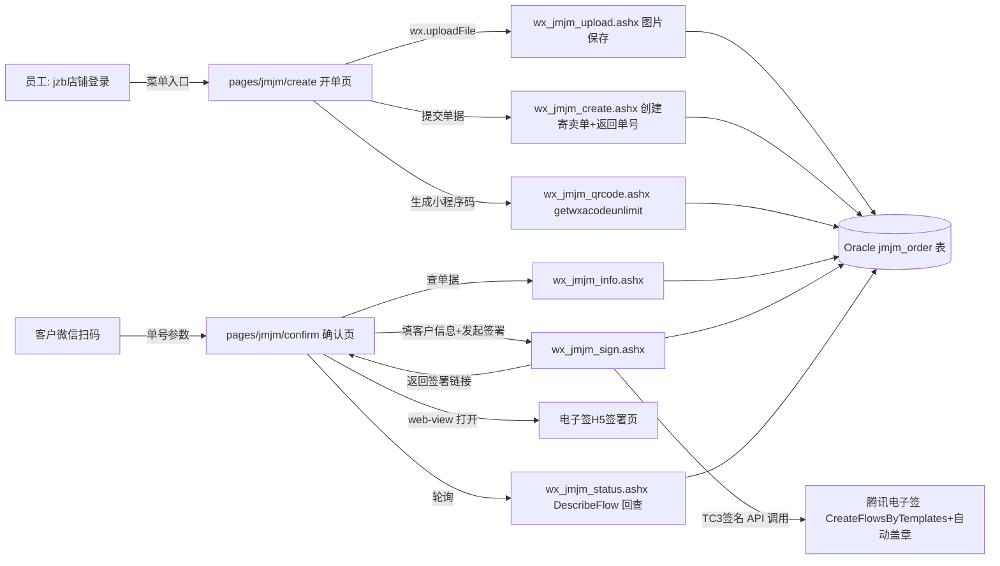

## Product Overview
在小程序内新增「金银币寄卖」功能，打通“员工开单 → 客户扫码 → 填写信息 → 腾讯电子签签署”全流程。

## Core Features
- **员工开单页**（店铺登录后菜单进入）：拍照/上传货品照片、填写货品名称、寄售价格、寄售数量，提交后生成寄卖单并展示带参小程序码供客户扫码；同店员工可查看已开单据及签署状态。
- **客户确认页**（微信扫码进入）：展示寄卖单货品信息，客户填写姓名、联系电话、身份证号、联系地址；点击“签署电子合同”跳转腾讯电子签完成签署。
- **电子签对接**：使用已开通的腾讯电子签企业 API + 已有合同模板，客户单方签署 + 企业自动盖章，客户签完即生效；签署状态回查更新单据状态。
- **数据落库**：寄卖单信息、客户信息（身份证号敏感数据安全存储）、签署状态入 Oracle。


## Tech Stack
- 前端：微信小程序原生（WeChat-ColorUI 模板风格，与现有 pages 一致的自定义导航栏 cu-custom 模式）
- 后端：HKsystem（FineUIPro.EmptyProjectNet40，ASP.NET WebForms + ashx + Oracle via oraclelink.Con，存储过程 OUT 游标模式，DLL_userlogin 员工验证）
- 第三方：腾讯电子签企业版 API（模板填充 + 自动盖章 + 签署链接），微信 getwxacodeunlimit 生成带参小程序码

## Implementation Approach
1. **员工开单**：新建 `pages/jmjm/create` 页面，从店铺登录（pages/jzb）登录后菜单进入（读取 storage 中 userid/shop 登录态）。拍照用 wx.chooseMedia→wx.uploadFile 直传后端保存；提交创建寄卖单返回单号；前端请求生成小程序码接口，弹窗展示二维码图片。
2. **客户确认**：新建 `pages/jmjm/confirm` 页面，onLoad 接收寄卖单号参数，查询并展示货品信息（照片/名称/价格/数量）；客户填四项信息（前端校验手机号/身份证格式），提交后由后端调用腾讯电子签 API 创建签署流程（模板填充客户信息 + 企业自动盖章组件），返回签署链接；前端通过 web-view 打开 H5 签署页（需在小程序后台配置电子签业务域名），并轮询签署状态，签署完成后展示成功页。
3. **电子签对接要点**：执行阶段先用 web_fetch 查腾讯电子签官方最新文档（cloud.tencent.com/document/product/1323）确认 CreateFlowsByTemplates、自动盖章、签署链接与回调的最新接口与参数，再实现；FlowID 与状态落库；签名（TC3-HMAC-SHA256）在后端实现，密钥不入前端。
4. **防绕过与安全**：身份证号仅后端存储并脱敏返回展示；签署链接一次性/短时效；状态流转后端裁决。

## Architecture Design


## Directory Structure
```
WeChat-ColorUI-shop-templet-master/
├── pages/jmjm/create/index.js|wxml|wxss|json   # [NEW] 员工开单页：拍照上传、货品表单、单号生成、二维码弹窗、我的寄卖单列表
├── pages/jmjm/confirm/index.js|wxml|wxss|json  # [NEW] 客户确认页：查单据、填客户四项信息、跳电子签、轮询签署结果
├── app.json                                    # [MODIFY] 注册 2 个新页面
├── pages/jzb/index/index.js|wxml               # [MODIFY] 登录后菜单新增「金银币寄卖」入口
├── wx_jmjm_upload.ashx.cs                      # [NEW] 图片接收保存（multipart，存 HKback/upload/jmjm/）
├── wx_jmjm_create.ashx.cs                      # [NEW] 创建寄卖单（员工身份校验+写库+返回单号）、寄卖单列表查询
├── wx_jmjm_qrcode.ashx.cs                      # [NEW] 按单号生成带参小程序码（同 wx_cj_qrcode 方式）
├── wx_jmjm_info.ashx.cs                        # [NEW] 客户扫码查单据（状态校验：仅未签署可签）
├── wx_jmjm_sign.ashx.cs                        # [NEW] 保存客户信息+调腾讯电子签创建签署流程（自动盖章）+返回签署链接
├── wx_jmjm_status.ashx.cs                      # [NEW] 电子签 Flow 状态回查（DescribeFlow）+ 状态落库
├── create_table_jmjm_order.sql                 # [NEW] Oracle 建表脚本（DBA 执行）
```

## Key Code Structures
- `jmjm_order` 表核心字段：ID(主键/单号)、IMG_PATH、GOODS_NAME、PRICE、QTY、STAFF_ID、SHOP_NO、CUST_NAME、CUST_PHONE、CUST_IDCARD、CUST_ADDR、FLOW_ID、SIGN_URL、STATUS(0待客户填写/1待签署/2已签署/9失败)、CREATE_TIME、SIGN_TIME。
- 后端统一返回格式 `{"errcode":0,"errmsg":"ok",...}`，错误码复用现有惯例（-1缺参/-8系统繁忙/-12记录不存在/-13权限）。
- 电子签配置（SecretId/SecretKey/模板ID/企业ID）放 ashx 配置区常量（同 _wxAppid/_wxSecret 现有风格），执行阶段可改为从配置文件读取。


## Design Style
延续现有页面体系：自定义导航栏（渐变橙红 `linear-gradient(45deg,#ff9700,#ed1c24)`，同 jzb/lqjp）+ 头部水波动画 + 白色圆角内容卡片（shadow-lg）。主色采用金色 #b8860b（与抽奖/核销体系一致），整体为「简洁表单 + 拍照卡片 + 二维码弹窗」的实用风格，弱化装饰、强化表单可读性。
## 页面规划（2 个页面）
1. **员工开单页 pages/jmjm/create**
   - 顶部导航：渐变橙红 + 标题「金银币寄卖」
   - 拍照卡片：虚线边框上传区，未拍时显示相机图标+「拍摄货品照片」，拍后展示图片缩略图可重拍/多图预览
   - 表单区：货品名称（input）、寄售价格（数字键盘 input，元）、寄售数量（stepper），金色圆角「生成寄卖单并出示二维码」主按钮
   - 二维码弹窗：与 lqjp 的 qrcode-dialog 样式统一（白底金边），展示小程序码 + 提示「请客户使用微信扫码确认寄卖信息」
   - 底部「我的寄卖单」列表：单号/货品/状态标签（待签署·金色 / 已签署·绿色 / 已过期·红色）
2. **客户确认页 pages/jmjm/confirm**
   - 顶部导航：标题「寄卖确认」
   - 货品信息卡：货品照片（aspectFit 大图）+ 名称/价格/数量三列信息
   - 客户信息表单：姓名、联系电话、身份证号、联系地址四个 input（身份证/手机号前端格式校验，错误红字提示）
   - 底部金色主按钮「签署电子合同」；签署后轮询态显示「等待签署完成…」，完成态显示绿色成功卡片（同 lqjp 领取成功风格：对勾图 + 领取成功标题）
## Interaction
- 提交按钮防连点（loading 态）；表单校验失败字段红色提示；轮询参考 lqjp startPoll 3s 间隔、10 分钟超时
- 弹窗可关闭，二维码长按可保存（wx.previewImage）

## Agent Extensions
### SubAgent
- **code-explorer**
  - Purpose: 在实施前深入探索 jzb 店铺登录后的菜单结构与登录态存储方式、poster/scdeposit 等页面的 wx.uploadFile 图片上传与后端接收模式、以及根目录现有 ashx.cs 的完整风格
  - Expected outcome: 产出员工入口接入点、图片上传复用模式、后端接口风格对照清单，保证新页面/接口与现有代码一致
### Skill
- （无需使用）
